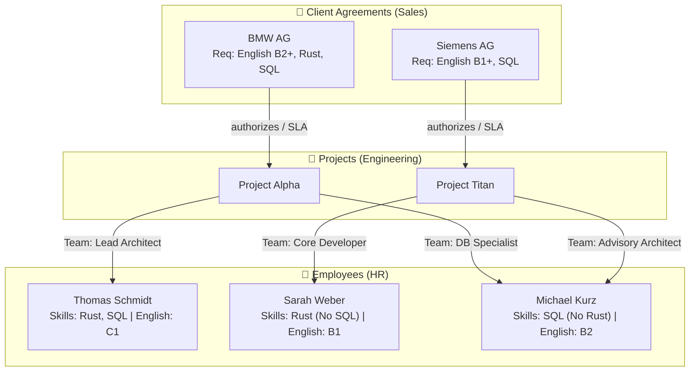

# 🚀 Showcase Guide: Hybrid RAG & GraphRAG with Rust & SurrealDB

This document serves as a complete walkthrough for demonstrations, presentations, and benchmarks of the **100% Rust RAG & GraphRAG Stack**. It explains the business scenario, the underlying knowledge graph, the step-by-step setup, and concrete multi-hop prompts for live demos.

---

## 🎯 1. Goal of the Showcase

Pure semantic vector search (**Vector RAG**) reaches its limits whenever information distributed across multiple separate documents must be logically connected (**Multi-Hop Reasoning**).

This showcase demonstrates:
1. **Why standard Vector RAG fails:** A client frame agreement does not list individual employee names, and an employee profile does not reference client SLAs. A simple vector similarity search fails to connect the dots across these isolated silos.
2. **How GraphRAG solves the problem:** By automatically extracting entities (Persons, Skills, Organizations, Projects, Standards) and graph edges (`mentions`, `relates_to`) in **SurrealDB**, the system traverses multi-hop relationships across document boundaries and delivers accurate reasoning.

---

## 📂 2. Test Documents Overview

All 7 sample PDF documents are pre-generated in the repository directory:
👉 **[`showcase_documents/`](./showcase_documents/)**

### 👤 Employee Profiles (`HR/`)
| File | Core Technical Skills | Language Level | Assigned Project |
| :--- | :--- | :--- | :--- |
| **`Mitarbeiter_Thomas_Schmidt.pdf`** | **Rust** (Expert), **SQL** (SurrealDB, PostgreSQL) | **English C1** | Project Alpha |
| **`Mitarbeiter_Sarah_Weber.pdf`** | **Rust** (Advanced), NoSQL (MongoDB, Redis) – *no SQL* | **English B1** | Project Titan |
| **`Mitarbeiter_Michael_Kurz.pdf`** | **SQL** (Master), Python, Java, Go – *no Rust* | **English B2** | Project Alpha & Titan |

### 🏢 Client Frame Agreements / SLAs (`Sales/`)
| File | Client | Mandatory Requirements | Authorized Project |
| :--- | :--- | :--- | :--- |
| **`Kundenvereinbarung_BMW_AG.pdf`** | **BMW AG** | • **English min. B2**<br/>• Skills: **Rust** AND **SQL** | Project Alpha |
| **`Kundenvereinbarung_Siemens_AG.pdf`** | **Siemens AG** | • **English min. B1**<br/>• Skills: **SQL** (Rust desired) | Project Titan |

### 🚀 Project Documentation (`Projects/`)
| File | Project | Client | Assigned Team |
| :--- | :--- | :--- | :--- |
| **`Projekt_Alpha_Dokumentation.pdf`** | **Project Alpha** | BMW AG | Thomas Schmidt (Lead), Michael Kurz (Database) |
| **`Projekt_Titan_Dokumentation.pdf`** | **Project Titan** | Siemens AG | Sarah Weber (Ingestion), Michael Kurz (Advisory) |

---

## 🕸️ 3. Knowledge Graph Topology



---

## 🛠️ 4. Preparation & Document Ingestion

### Step 1: Build and Start the Containers
Make sure the latest build is running:
```bash
docker compose build rag-orchestrator && docker compose up -d rag-orchestrator
```
Open the Web UI in your browser: **`http://localhost:8080`**

### Step 2: Batch Upload with Automatic Folder Detection
1. Click the **`➕` (Upload)** icon at the bottom left of the sidebar.
2. In the upload modal, click **`📁 Select Folder (Batch)`** (*`📁 Ordner wählen (Batch)`*).
3. Select the **`showcase_documents/`** directory.
   - The UI automatically detectssubfolder categories:
     - `HR/` $\rightarrow$ Category `HR`
     - `Projects/` $\rightarrow$ Category `Projects`
     - `Sales/` $\rightarrow$ Category `Sales`
   - The file preview immediately shows the detected categories, e.g., `📄 [HR] Mitarbeiter_Thomas_Schmidt.pdf`.
4. *(Optional)* If you enter a prefix like `Showcase` in the category text field, it automatically combines them into `Showcase / HR`, `Showcase / Projects`, etc.
5. **Important:** Ensure both checkboxes are checked:
   - `[x] Automatically replace older revisions sharing the same document title`
   - `[x] Automatically extract Knowledge Graph relations (entities & edges via LLM) during upload`
6. Click **`🚀 Upload & index 7 selected file(s)`**.
7. The progress bar tracks PDF text extraction, vector embedding generation, and LLM-based Knowledge Graph extraction (entities & relations).

---

## 🧪 5. Live Demo & Test Prompts

Because the embedding model (`BAAI/bge-m3`) and cross-encoder rerankers are multilingual, you can ask questions in **English** or **German**.

> **Tip for Multi-Document Reasoning:**  
> In **Settings (`⚙️`)**, set **Top-N Chunks** to **`6 Chunks`** (or `8 Chunks`) and **Context Window** to **`16k`** so all relevant employee profiles and contracts are included simultaneously.

### 🌟 Scenario 1: Classic 3-Hop Multi-Hop Query
> **Prompt (EN):**  
> *"Which employee meets all technical and language requirements for BMW AG, and which specific project are they assigned to?"*  
> **Prompt (DE):**  
> *„Welcher Mitarbeiter erfüllt alle fachlichen und sprachlichen Anforderungen für die BMW AG und in welchem konkreten Projekt ist er eingesetzt?“*

- **Expected Answer:**  
  **Thomas Schmidt**, assigned to **Project Alpha** as Lead Backend/Systems Architect. He has proven expertise in both **Rust** and **SQL** and holds an **English C1** certificate (exceeding BMW's mandatory B2 minimum).
- **Why this is impressive:**  
  The BMW agreement contains no employee names, and Thomas Schmidt's profile never mentions BMW. Only the bridge across the project documentation and SurrealDB's graph traversal (`->mentions->entity->relates_to->entity`) connects all three hops.

---

### 🎓 Scenario 2: Follow-up Gap Analysis & Upskilling (Conversational Memory)
> **Follow-up Prompt (EN):**  
> *"Which other employees could be considered if they only need further training in a single requirement?"*  
> **Follow-up Prompt (DE):**  
> *„Welche Mitarbeiter kommen noch infrage, die vielleicht nur eine Weiterbildung bei einer Anforderung brauchen?“*

- **Expected Answer:**  
  - **Michael Kurz:** Already meets the **SQL** and **English B2** requirements (and already supports Project Alpha's data layer), but explicitly lacks **Rust** (`No Rust`). He would only need **Rust training**.
  - **Sarah Weber:** Has strong **Rust** skills (3 years), but only has **English B1** (needs upskilling to **B2**) and currently works with NoSQL databases rather than **SQL** database design.

---

### 🛡️ Scenario 3: Compliance & Contractual Exclusion Criteria
> **Prompt (EN):**  
> *"Why is Sarah Weber not eligible to work on the BMW AG client project? List the specific contractual reasons."*  
> **Prompt (DE):**  
> *„Warum darf Sarah Weber nicht für das Kundenprojekt der BMW AG eingesetzt werden? Nenne die konkreten vertraglichen Gründe.“*

- **Expected Answer:**  
  1. **Language Requirement:** BMW requires at least **English B2**, whereas Sarah Weber is at **B1**.  
  2. **Technical Skills Gap:** BMW mandates **SQL database design**, whereas Sarah Weber specializes in NoSQL (Redis, SQLite, MongoDB).  
  3. **Project Allocation:** She is currently assigned to **Project Titan** for **Siemens AG** (where English B1 is sufficient).

---

### 🔍 Scenario 4: Skill-Based Cross-Project Intersection
> **Prompt (EN):**  
> *"Which employees are proficient in SQL and which projects are they currently working on?"*  
> **Prompt (DE):**  
> *„Welche Mitarbeiter beherrschen SQL und an welchen Projekten arbeiten sie aktuell?“*

- **Expected Answer:**  
  1. **Thomas Schmidt** – Project Alpha  
  2. **Michael Kurz** – Both Project Alpha (Data Layer) and Project Titan (Advisory Data Architect)

---

### 📊 Scenario 5: Complete Project & Client Compliance Matrix
> **Prompt (EN):**  
> *"Provide a markdown table comparing all projects, their respective clients, mandatory contractual requirements, and assigned team members."*  
> **Prompt (DE):**  
> *„Gib mir eine tabellarische Übersicht über alle Projekte, die jeweiligen Kunden, die vertraglichen Mindestanforderungen und die zugeordneten Mitarbeiter.“*

- **Expected Answer:**  
  A structured Markdown table contrasting **Project Alpha** (BMW AG, English B2 + Rust + SQL, Thomas Schmidt & Michael Kurz) and **Project Titan** (Siemens AG, English B1 + SQL, Sarah Weber & Michael Kurz).

---

## 🏗️ 6. Under the Hood (Technical Architecture Highlights)

Key talking points for technical audiences:

1. **SurrealDB 4.0 Multi-Model Engine:**
   - Vector search (HNSW), full-text search (BM25), and Knowledge Graph relations (`chunk->mentions->entity` and `entity->relates_to->entity`) reside in **a single unified database** with zero external synchronization overhead.
2. **Hybrid Search with Reciprocal Rank Fusion (RRF):**
   - Combines dense semantic embeddings (`BAAI/bge-m3`) with BM25 lexical keyword matching inside SurrealDB.
3. **Knowledge Graph Prompt Augmentation:**
   - For every retrieved text chunk, the orchestrator traverses the 2-hop entity neighborhood (`->mentions->entity->relates_to->entity`) and injects the verified graph triplets into the LLM system context.
4. **Two-Stage Cross-Encoder Reranking:**
   - Supports ultra-fast in-process ONNX reranking (`mmarco-mMiniLMv2-L12-H384-v1`, ~250ms) and high-precision TEI reranking (`BAAI/bge-reranker-v2-m3`), filtering out noise before LLM generation.
5. **Interactive 100% Rust WebAssembly UI (Leptos CSR):**
   - Live token streaming, collapsible `<think>` reasoning inspector for thinking models (e.g. `deepseek-r1`), real-time Markdown rendering, expandable Knowledge Graph inspector, and 1-click Markdown chat export.
