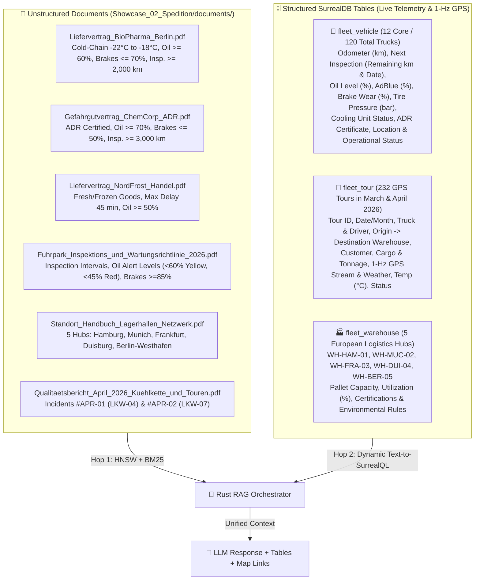

# 🚛 Showcase 02: Logistics, Fleet Telemetry, 1-Hz GPS Tours (March & April) & Warehouses

This showcase demonstrates a **production-grade logistics and freight forwarding scenario**, combining **unstructured PDF documents (maintenance policies, customer SLAs, warehouse manuals, and quality audit reports)** with **structured fleet telemetry, 1-Hz GPS tour streams, and warehouse tables in SurrealDB** via the **Dynamic Text-to-SurrealQL Engine**.

---

## 🚀 1. Quick Start (`--showcase`)

By default, `./setup.sh` starts without any showcase loaded. To load Showcase 02 (all 6 PDFs + all 3 database tables), run:

```bash
./setup.sh --showcase 2
# or:
./setup.sh --showcase spedition
```

> **In the Browser (`http://localhost:8080`):**
> In the top-right header of the Chat UI, you will see the active showcase badge (**`🚛 Showcase 02: Spedition (120 Trucks · 232 Tours · 6 PDFs)`**). Clicking it (or clicking **`🗄️ SQL/DB`** at the bottom left of the sidebar) opens the fullscreen database explorer where you can inspect all 120 trucks, 232 GPS tours, and 5 warehouses, or open interactive **OpenStreetMap (Leaflet.js)** route maps.

---

## 🏗️ 2. Architecture & Data Model



---

## 📊 3. Ground Truth Data Reference

### A. 5 European Warehouses (`fleet_warehouse`)

| Warehouse ID | Name | City | Type | Capacity (Utilization) | Certifications | Key Restrictions / Features | Manager |
| :--- | :--- | :--- | :--- | :---: | :--- | :--- | :--- |
| **`WH-HAM-01`** | Zentrallager Hamburg-Hafen | Hamburg | Overseas, Deep-Freeze & Hazmat | 12,000 Pal. (`82%`) | IFS, ADR, EU-GDP | 24/7 operation, heavy-duty crane up to 40t | Henrik Lindqvist |
| **`WH-MUC-02`** | Logistik-Hub München-Nord | Munich | Automotive & High-Tech Cross-Docking | 8,500 Pal. (`76%`) | ISO 9001, TISAX | High-power fast chargers for electric trucks | Markus Bichler |
| **`WH-FRA-03`** | Pharma- & AirCargo-Kühllager Frankfurt-Süd | Frankfurt | GDP Pharma Cold Storage (-25°C to +8°C) | 6,000 Pal. (`91%`) | EU-GDP, ISO 13485 | Access only with GDP thermo certificate | Dr. Claudia Mertens |
| **`WH-DUI-04`** | Rhein-Ruhr Gefahrgut-Depot Duisburg | Duisburg | ADR Hazmat & Chemical Hub | 9,500 Pal. (`68%`) | ADR Seveso-III, ISO 14001 | Retention basins for ADR Class 3 & 9 | Frank Hufnagel |
| **`WH-BER-05`** | City-Hub Berlin-Westhafen | **Berlin** | Urban Distribution & Pharma/Fresh | 5,500 Pal. (`88%`) | EU-GDP, IFS Food | **Strictly Euro-6d or Electric trucks only! No ADR Class 3 bulk storage.** | Sabine Krumm |

---

### B. 12 Core Long-Haul Trucks (`fleet_vehicle`)

Sorted by **inspection urgency** (`km_until_inspection`):

| Truck ID | License Plate & Model | Type & Emission | Driver | Odometer | Next Inspection (Rem. km / Date) | Oil Level | AdBlue | Brakes | Tires | Cooling Unit & ADR | Operational Status |
| :--- | :--- | :--- | :--- | :---: | :--- | :---: | :---: | :---: | :---: | :--- | :--- |
| **`LKW-07`** | `HH-LG-2077` (MAN TGX 18.510 Mega) | Heavy-Duty (`Euro-6c`) | Murat Demir | **249,820 km** | at 250,000 km (**only 180 km!** / `2026-05-02`) | **34% (CRITICAL Red)** | 14% | **88% (CRITICAL)** | **7.2 bar** | None / ADR: No | 🔴 **Blocked / Workshop Required** |
| **`LKW-12`** | `M-SL-1222` (MAN TGX 26.580) | Heavy-Duty (`Euro-6d`) | Florian Bichler | **199,550 km** | at 200,000 km (**only 450 km!** / `2026-05-08`) | **48% (Warning Yellow)** | 31% | **81% (Warning)** | 8.2 bar | None / ADR: No | 🔴 **Blocked / Workshop Required** |
| **`LKW-04`** | `F-TH-4014` (Mercedes Actros 1848) | Pharma Reefer (`Euro-6d`) | Viktor Makarov | **173,900 km** | at 175,000 km (**1,100 km** / `2026-05-12`) | **38% (CRITICAL Red)** | 19% | 74% | **7.4 bar** | **DEFECTIVE (-14.2°C Alert)** | 🔴 **Blocked / Workshop Required** |
| **`LKW-02`** | `HH-LG-2042` (Scania R 450) | Fresh Reefer (`Euro-6d`) | Stefan Lindemann | **198,650 km** | at 200,000 km (**1,350 km** / `2026-05-20`) | **54% (Warning Yellow)** | 64% | 76% | 8.3 bar | Active (-18°C/+4°C) / ADR: No | 🟡 **Restricted (Short-haul only)** |
| **`LKW-10`** | `DU-CH-1020` (Mercedes Actros 1845) | ADR Hazmat (`Euro-6d`) | Christian Hummels | **148,100 km** | at 150,000 km (**1,900 km** / `2026-05-25`) | **62%** (<70% ADR limit) | 55% | **58%** (>50% ADR limit) | 8.1 bar | None / **ADR: Yes** | 🟡 **Blocked for ChemCorp ADR** |
| **`LKW-09`** | `B-TR-9019` (Scania S 500) | Pharma Reefer (`Euro-6d`) | Elena Berger | **91,300 km** | at 100,000 km (**8,700 km** / `2026-08-05`) | **91% (OK)** | 88% | 25% | 8.5 bar | Active (-20.5°C GDP) / ADR: No | 🟢 **Ready (Berlin)** |
| **`LKW-01`** | `M-SP-4011` (Mercedes Actros L 1851) | Pharma Reefer (`Euro-6d`) | Andreas Kowalski | **141,200 km** | at 150,000 km (**8,800 km** / `2026-07-15`) | **88% (OK)** | 82% | 28% | 8.5 bar | Active (-20.0°C GDP) / ADR: No | 🟢 **Ready (Berlin)** |
| **`LKW-03`** | `DU-CH-3093` (Volvo FH 540) | ADR Hazmat (`Euro-6d`) | Mehmet Yilmaz | **87,400 km** | at 100,000 km (**12,600 km** / `2026-09-10`) | **92% (OK)** | 90% | 22% | 8.6 bar | None / **ADR: Yes** | 🟢 **Ready (Duisburg)** |
| **`LKW-08`** | `S-IN-8088` (DAF XG+ 530) | Curtain-Sider (`Euro-6d`) | Timo Brandt | **132,400 km** | at 150,000 km (**17,600 km** / `2026-08-18`) | **79% (OK)** | 68% | 44% | 8.4 bar | None / ADR: No | 🟢 **Ready (Munich)** |
| **`LKW-06`** | `HH-AD-6066` (MAN TGX 18.510 ADR) | ADR Hazmat (`Euro-6d`) | Lukas Petersen | **118,500 km** | at 150,000 km (**31,500 km** / `2026-10-15`) | **84% (OK)** | 75% | 38% | 8.5 bar | None / **ADR: Yes** | 🟢 **Ready (Hamburg)** |
| **`LKW-05`** | `M-EV-5055` (Volvo FH Electric) | Electric Pharma Reefer | Katrin Baumann | **64,100 km** | at 100,000 km (**35,900 km** / `2026-11-01`) | **96% (OK)** | 100% | 18% | 8.5 bar | Active (-21.0°C GDP) / ADR: No | 🟢 **Ready (Munich)** |
| **`LKW-11`** | `F-FR-1121` (IVECO S-Way 490 LNG) | Curtain-Sider (`Euro-6d`) | Marco Rossi | **211,000 km** | at 250,000 km (**39,000 km** / `2026-10-30`) | **81% (OK)** | 72% | 39% | 8.5 bar | None / ADR: No | 🟢 **Ready (Frankfurt)** |

---

### C. GPS Tours to Berlin in April 2026 (`fleet_tour`)

In **April 2026**, there were **6 deliveries to Berlin (`WH-BER-05`)**, performed by **5 trucks (`LKW-01`, `LKW-02`, `LKW-04`, `LKW-06`, `LKW-09`)**:
1. **`TOUR-2026-0402` (2026-04-04)**: **`LKW-01` (`M-SP-4011`, Andreas Kowalski)** | `Frankfurt` $\rightarrow$ **`Berlin`** | Customer: **BioPharma Berlin GmbH** | Cargo: *mRNA vaccines & biologics (16.5 t, -19.8 °C)* | **On time & SLA compliant**.
2. **`TOUR-2026-0405` (2026-04-09)**: **`LKW-02` (`HH-LG-2042`, Stefan Lindemann)** | `Hamburg` $\rightarrow$ **`Berlin`** | Customer: **REWE Großhandel Ost & NordFrost** | Cargo: *Frozen food & dairy (21.0 t, -18.4 °C)* | **On time & SLA compliant**.
3. **`TOUR-2026-0412` (2026-04-14)**: **`LKW-04` (`F-TH-4014`, Viktor Makarov)** | `Frankfurt` $\rightarrow$ **`Berlin`** | Customer: **BioPharma Berlin GmbH** | Cargo: *Blood plasma concentrates (14.2 t, **-14.2 °C**)* | ⚠️ **SLA VIOLATION: Cooling temperature rose to -14.2 °C (defective thermostat valve) + 65 min delay**.
4. **`TOUR-2026-0418` (2026-04-19)**: **`LKW-06` (`HH-AD-6066`, Lukas Petersen)** | `Duisburg` $\rightarrow$ **`Berlin`** | Customer: **Siemens Energy & BatteryTech Berlin** | Cargo: *Lithium-ion high-voltage storage ADR Class 9 (19.8 t)* | **On time & ADR compliant**.
5. **`TOUR-2026-0423` (2026-04-24)**: **`LKW-09` (`B-TR-9019`, Elena Berger)** | `Hamburg` $\rightarrow$ **`Berlin`** | Customer: **BioPharma Berlin GmbH** | Cargo: *Clinical diagnostics & vaccines (15.0 t, -20.2 °C)* | **On time & SLA compliant**.
6. **`TOUR-2026-0428` (2026-04-28)**: **`LKW-01` (`M-SP-4011`, Andreas Kowalski)** | `Munich` $\rightarrow$ **`Berlin`** | Customer: **Charité & BioPharma Berlin GmbH** | Cargo: *Medical technology & sterile thermo-reagents (17.2 t, -19.5 °C)* | **On time & SLA compliant**.

---

## 🧪 4. Copy-Paste Test Prompts for Live Demos

### Scenario 1: Drivers Ranked Descending by Kilometers Driven in April (`GROUP BY` + `ORDER BY`)
> **Prompt (EN):**
> *"List all drivers sorted descending by kilometers driven in April 2026, including their truck ID, number of tours, and total kilometers."*
> **Prompt (DE):**
> *„Liste mir alle Fahrer auf, absteigend sortiert nach den gefahrenen Kilometer im April.“*

- **Expected Result:**
  Dynamically generates `SELECT driver_name, truck_id, math::sum(distance_km) AS total_km, count() AS tours FROM fleet_tour WHERE month = 'April 2026' GROUP BY driver_name, truck_id ORDER BY total_km DESC;` and returns the exact descending ranking:
  1. **Andreas Kowalski (`LKW-01`)**: **1,133 km** (2 tours)
  2. **Murat Demir (`LKW-07`)**: **775 km** (1 tour)
  3. **Florian Bichler (`LKW-12`)**: **615 km** (1 tour)
  4. **Viktor Makarov (`LKW-04`)**: **548 km** (1 tour)
  5. **Lukas Petersen (`LKW-06`)**: **525 km** (1 tour)

---

### Scenario 2: Deliveries to Berlin in April (`WHERE destination_city = 'Berlin' AND month = 'April 2026'`)
> **Prompt (EN):**
> *"Which trucks delivered goods to Berlin in April 2026? List all Berlin deliveries in April with tour ID, date, truck, license plate, driver, customer, cargo, and delivery status."*
> **Prompt (DE):**
> *„Welcher LKW hat im April Ware nach Berlin geliefert? Liste alle Berlin-Lieferungen im April tabellarisch mit Tour-ID, Datum, LKW, Kennzeichen, Fahrer, Kunde, gelieferter Ware und Lieferstatus auf.“*

- **Expected Result:**
  Lists the **6 April tours to Berlin (`TOUR-2026-0402`, `0405`, `0412`, `0418`, `0423`, `0428`)** with clickable `[🗺️ Karte](/v1/fleet/tours/.../map)` OpenStreetMap links and highlights the cold-chain violation on `TOUR-2026-0412` (`LKW-04`, `-14.2 °C`).

---

### Scenario 3: Multi-Hop Compliance (BioPharma Cold-Chain SLA PDF $\times$ Live Truck Telemetry)
> **Prompt (EN):**
> *"We need to schedule a 600 km pharma cold-chain delivery for BioPharma Berlin GmbH to Berlin-Westhafen next week. What mandatory vehicle requirements does the BioPharma contract specify, which of our refrigerated trucks currently meet ALL criteria, and why are LKW-04 and LKW-02 disqualified?"*
> **Prompt (DE):**
> *„Wir müssen nächste Woche eine neue Pharma-Kühlkettenlieferung (600 km) für die BioPharma Berlin GmbH nach Berlin-Westhafen planen. Welche Pflichtanforderungen schreibt der BioPharma-Liefervertrag für das Fahrzeug vor, welche unserer Kühl-LKWs erfüllen aktuell ALLE Kriterien und warum fällt LKW-04 oder LKW-02 aus?“*

- **Expected Result (2-Hop across `Liefervertrag_BioPharma_Berlin.pdf` + `fleet_vehicle`):**
  1. **Contract Rules from PDF:** GDP Pharma reefer (`-22 °C` to `-18 °C`), **oil level $\ge 60\%$**, **brake wear $\le 70\%$**, **remaining distance to inspection $\ge 2,000\text{ km}$**, **Euro-6d or Electric** (Berlin low-emission zone).
  2. **Eligible Trucks (100% Match):** `LKW-01` (Andreas Kowalski), `LKW-09` (Elena Berger), `LKW-05` (Katrin Baumann, Volvo FH Electric).
  3. **Disqualified Trucks:** `LKW-04` (defective cooling unit `-14.2 °C`, oil `38%`, brakes `74%`, inspection due in `1,100 km`) and `LKW-02` (oil `54%`, brakes `76%`, inspection due in `1,350 km`, no GDP certification).

---

### Scenario 4: 1-Hz High-Frequency GPS Stream (605 Seconds) & Elbtunnel Satellite Loss
> **Prompt (EN):**
> *"Show me the tours of truck HH-LG-2077 (LKW-07) and open the 1-Hz GPS map for TOUR-2026-0415."*
> **Prompt (DE):**
> *„Wie viele Touren ist der HH-LG-2077 gefahren und wo gab es auf der Strecke im Elbtunnel Probleme mit dem GPS-Empfang?“*

- **Expected Result:**
  Lists `TOUR-2026-0318` and `TOUR-2026-0415` with a direct `[🗺️ Karte](/v1/fleet/tours/TOUR-2026-0415/map)` link to the interactive **605-point 1-Hz OpenStreetMap replay** from Munich to Hamburg, including the 240-second GNSS blackout (`0 satellites`, `HDOP 99.9`, `±124.7 m` drift) inside the Hamburg Elbtunnel under heavy storm/rain (`33.4 mm/h`, `86 km/h` wind).
